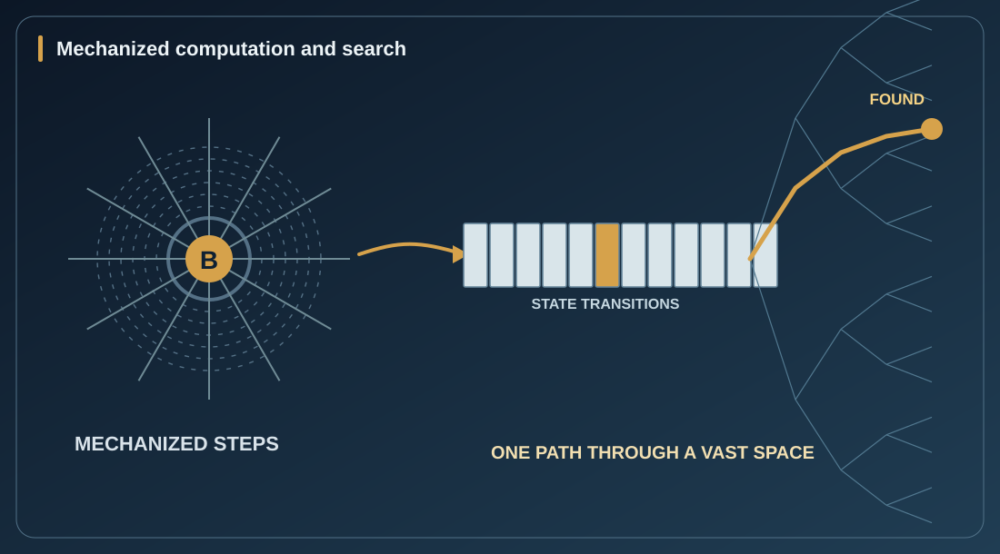
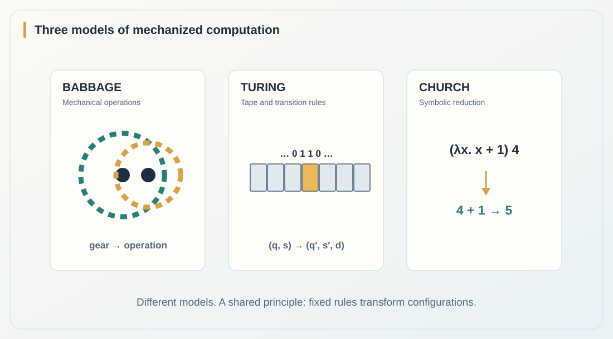
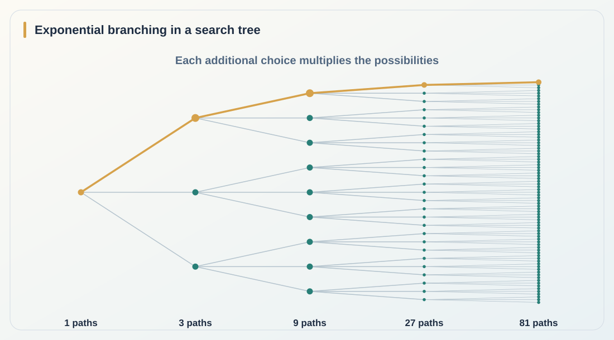
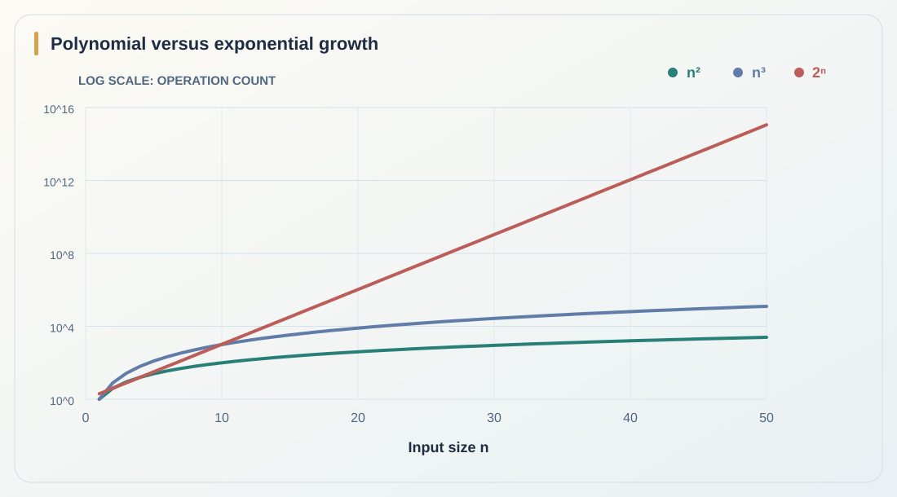
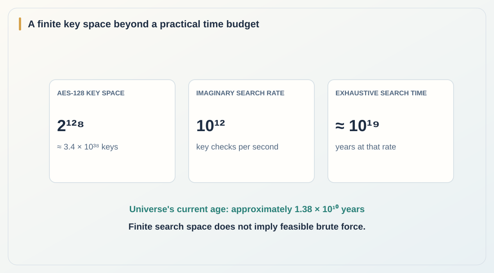
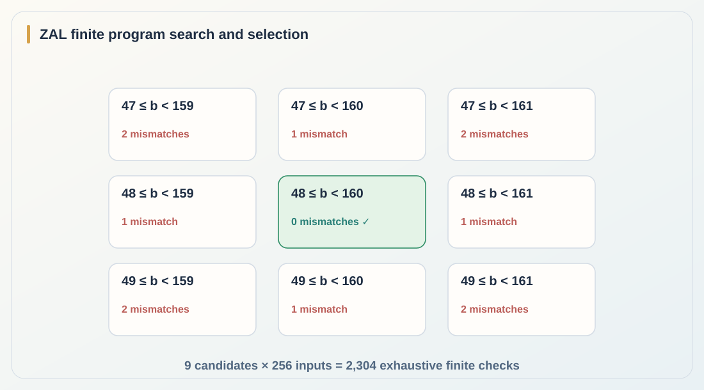
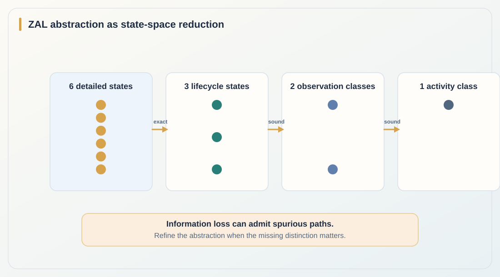
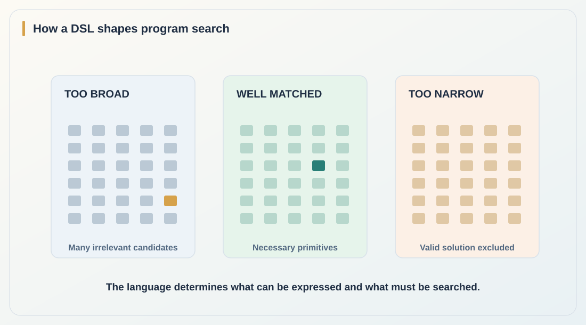
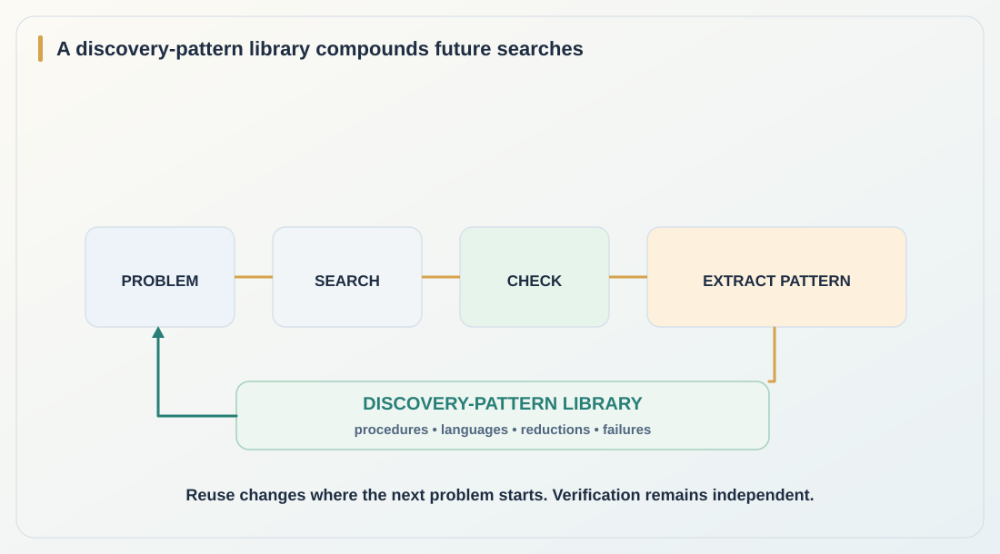

# Program Synthesis Is Program Search and Selection

*An essay on computation, complexity, and the limits of what can be found.*

*Conceptual illustration generated for this essay. A single path through an enormous space of possibilities.*

**Premise: All problem solving is search.** By this I mean that every well-defined problem can be represented as a search for an answer that satisfies some condition. The answer might be a number, an explanation, a proof, a plan, a sequence of actions, or a computer program. We start with a question. We can define a space of candidate answers and conditions that determine which of them count as solutions. Problem solving is the process of finding a solution, or establishing that none exists.

This is a way of *modeling* problems. It is not a claim that every algorithm literally tries every possible answer, or even that it explicitly enumerates alternatives. That distinction matters, because the entire point of a good algorithm is often to avoid the search we would otherwise have to perform.

The question is therefore not simply, **Can we search?** We can. The question is, **Can we search efficiently enough to find what we need within the resources available to us?**

## A problem defines a search space

We can make the premise precise. A problem is not literally a space of answers. It specifies what must be solved. Let **x** be a problem instance, **Y** the search space of candidate answers, and **R(x, y)** a relation saying that candidate **y** is a satisfactory answer to **x**. The **solution set**, which contains only candidates satisfying the condition, is:

`S(x) = { y ∈ Y : R(x, y) }`

The search space **Y** contains the candidates we might consider; the solution set **S(x)** is the subset of valid solutions. Solving the problem means finding some **y** in **S(x)**, perhaps the best one by some criterion, or determining that the set is empty. The relation may itself be difficult or even impossible to decide mechanically. Writing down the search formulation does not magically give us an algorithm.

Take a maze: the candidates are possible routes, and the condition is whether a route reaches the exit without violating the rules. Take a mathematical conjecture: candidates may be proofs, and checking a valid proof can be far easier than discovering it. Take software: candidates are programs, and the condition is whether a program has the required behavior.

This is the direct connection to program synthesis. **Program synthesis is program search and selection.** We describe what a program must do, generate or construct candidate programs, reject those that fail, and select a program that meets the specification. The remaining questions are how we represent the candidates, how we search among them, how we check them, and what we mean by “best.”

## From Babbage to Church and Turing: computation becomes mechanical

Before asking whether a search can be efficient, we need to understand what it means to compute at all.

Charles Babbage's nineteenth-century Analytical Engine was designed to execute sequences of arithmetic operations using a mechanical store, a mill, punched instructions, and conditional control. The complete general-purpose engine was not built in his lifetime, but the idea was clear: a procedure need not remain an act of human calculation. Its steps can be carried out by machinery.

In the 1930s, Alonzo Church described effective calculation through symbolic rules, including the lambda calculus. An expression can be transformed through successive reductions. Alan Turing described a machine with a tape, a current state, and exact rules telling it what to read, write, and do next. These models look different, yet they illuminate the same basic concept: **a computation can be specified as a sequence of mechanically determined transformations.**

*Figure 1. Babbage's proposed machinery, Turing's tape and Church's lambda calculus describe distinct ways of making a procedure mechanical. A step transforms one configuration into another.*

Now comes the connection to search. A computation progresses through a space of possible configurations. At each step, a rule determines the next configuration. A deterministic machine follows one path; a search algorithm deliberately considers alternatives among many possible paths or answers. They are related, but they are not identical.

That difference gives us two kinds of search worth keeping separate: **search for a program** and **the computation performed by the program**. The first chooses an algorithm from possible algorithms. The second executes the chosen algorithm, which may itself perform a search or avoid one almost entirely.

## The branching problem

Suppose a problem offers three choices at every step. After one step, there are three possible paths. After two steps, nine. After three, twenty-seven. After **d** steps, there may be **3ᵈ** different paths. In general, a tree with branching factor **b** and depth **d** has **bᵈ** leaves if every branch continues to that depth.

*Figure 2. The branching problem. The number of possible paths grows exponentially with search depth. A clever algorithm may avoid examining most of them; the figure shows the space of possibilities, not a compulsory execution trace.*

This is the exponential blowup we encounter when searching state spaces. Every additional branch multiplies the possibilities. The existence of a solution says very little about how long it will take us to find it.

But the search tree is not destiny. Some branches can be rejected immediately. Some states are equivalent and can be merged. Some problems can be decomposed into smaller ones. Some constraints can rule out enormous regions without visiting them. The difference between an impossible brute-force search and a practical algorithm is often a change in how the search space is represented.

## Easy and hard are questions of resources

Humans and machines both compute. Neither has unlimited time, space, energy, or access to other computation. The same basic constraint applies whether the solver is a person with pencil and paper, a research team with a library, or a computer cluster.

**How much time does a human have?** It is finite. Suppose the only available procedure takes a thousand years, but a human lives eighty. Experience alone will not make that procedure finish within a lifetime. Neither will simply working harder. We must discover a cheaper procedure, obtain additional resources, divide the work where possible, or accept that it exceeds our budget.

And humans do not solve serious problems using working memory alone. We write things down. We use books. We build instruments. We use other people and the results of their work. Einstein did not develop the mathematics of general relativity entirely alone. His mathematician friend Marcel Grossmann helped him recognize the relevance of tensor calculus, and the two published together. This is an example of finding better mathematical tools through collaboration, not of computation somehow escaping resource constraints.

A notebook extends our usable memory. A book preserves results of earlier work. A collaborator contributes knowledge and computation. Computers also use external memory, libraries, specialized hardware, and other processors. Both humans and machines can expand their effective resources, but those resources remain finite.

Experience matters when it changes the method. Recognizing an invariant might replace centuries of enumeration with a short proof. A better representation might eliminate almost the entire search space. **But once the procedure and resources are fixed, calling the problem easy does not make it finish sooner.**

The important distinction is not between what is hard for humans and what is hard for machines. It is between the resources a method requires and the resources a solver can actually use. Formal complexity theory makes this precise by studying how resource requirements grow with input size under specified computational models. Practical difficulty asks whether the cost fits the available budget. Both questions begin with the same fact: **our resources are limited.**

## Complexity theory: when more input becomes more work

An algorithm's difficulty is not measured only by the time it takes on one example. We ask how its resource requirements grow as the input becomes larger.

An algorithm requiring roughly **n²** operations grows polynomially. One requiring roughly **2ⁿ** operations grows exponentially. Double **n**, and the consequences are radically different. Polynomial time is the standard theoretical benchmark for *tractability*, although a polynomial algorithm can still be impractical, and an exponential algorithm can be perfectly adequate for small instances.

*Figure 3. Operation counts as input size grows. On a logarithmic scale the exponential curve still overtakes the polynomial curves dramatically. These are illustrative functions, not measured runtimes for a particular machine.*

This gives us a way to describe how resource demands grow, independent of whether the solver is a person, a team, or a machine. The issue is not whether one instance can be solved. The issue is whether the resources grow slowly enough that increasingly large instances remain accessible.

One of complexity theory's most famous questions is **P versus NP**. **P** contains decision problems that can be solved in polynomial time. **NP** contains decision problems for which a *yes* answer has a certificate that can be checked in polynomial time. Is finding an answer always no harder, in this asymptotic sense, than checking one? We do not know. The P versus NP problem remains open.

There are also stronger, established limits. The time hierarchy theorem shows that giving algorithms substantially more time allows them to decide some problems that less time cannot. And the halting problem tells us something more severe: no algorithm can correctly decide, for every possible program and input, whether that program will eventually stop. Some limits are practical; others are limits of computability itself.

## When the search space is larger than our resources

The universe is not an unlimited computer. It has a finite age so far, and any bounded physical region has finite usable energy and information-processing capacity under our present physical theories. We should not assume that the entire universe has a finite number of atoms or a known final lifetime. We do not need those claims to see the limit: **any physical computer operating for a finite time has a finite computation budget.**

This is why the brute-force search for an AES key is a useful example. AES-128 has **2¹²⁸** possible keys, approximately **3.4 × 10³⁸**. Even if an imaginary machine could test a trillion keys every second without interruption, enumerating the entire key space would take approximately **10¹⁹ years**. The universe is about **13.8 billion years** old. Those two timescales are separated by roughly nine orders of magnitude.

*Figure 4. Classical brute-force illustration for AES-128. This does not prove the absence of better cryptanalytic attacks; it shows why merely increasing the rate of exhaustive search is not a general solution.*

The same logic appears in program synthesis, planning, verification, and combinatorial optimization. We may be able to list the possibilities in principle, but not finish the list before our resources run out. A finite search space is not necessarily a feasible search space.

## Could there be one algorithm that searches efficiently enough to solve everything?

This is the central question. Can we discover an algorithm that searches so efficiently that **all problems** can be solved in a practical amount of time?

If “all problems” is meant literally, the answer is **no**. Some problems are undecidable. No amount of ordinary algorithmic ingenuity can produce a general solver for the halting problem. Even among decidable problems, complexity hierarchies rule out a single fixed resource bound that captures every problem.

If we narrow the question to whether every efficiently checkable finite solution can also be found efficiently, we arrive at **P versus NP**. An affirmative answer would be an extraordinary mathematical discovery. But it would not mean that every problem was solved, nor would it guarantee practical runtimes for real inputs: polynomial exponents and constants can still be enormous.

This does not make search futile. It tells us what the real work is. Rather than hoping for one universal shortcut, we should ask what structure a particular problem offers. Can we change the representation? Find an invariant? Prove that two candidates are equivalent? Eliminate an entire branch with a counterexample? Reduce the problem to another one with a better decision procedure?

## Program synthesis: searching among programs

Here the initial premise becomes concrete. Define a language of candidate programs **L**, a specification **Spec**, and a domain **D**. We want a program **p** such that:

`p ∈ L &nbsp;and&nbsp; ∀x ∈ D, &nbsp; p(x) = Spec(x)`

We can also rank correct programs by size, execution time, memory use, readability, or some other cost. The synthesis problem is therefore both a **search problem** and a **selection problem**. Generating candidates is only part of it. We also need to know which candidates are correct, and then which correct candidate we prefer.

A small example can be generated and checked directly in ZAL. Suppose the specification is a byte classifier that returns true exactly when **48 ≤ b < 160**, for byte values from 0 through 255. In one bounded synthesis run, the checker explored nine nearby interval programs, tested each over all 256 byte inputs, and selected the single zero-mismatch candidate. That is **2,304 candidate-input checks** in a deliberately narrow search space.

*Figure 5. ZAL-generated evidence, rendered for this essay. Nine interval candidates were evaluated across the complete 256-byte input domain. The central program was selected with zero mismatches. This is exhaustive finite checking *within the specified neighborhood*, not unrestricted program synthesis or a compiled-Rust proof.*

The interesting part is not that nine candidates are difficult to search. They are not. The point is that this example makes the mechanism visible: **define the solution condition; generate candidates; check them; select a satisfactory program.** As the candidate language expands, the hard part becomes avoiding a combinatorial explosion while preserving confidence in the result.

Abstraction is one way to do that. A second ZAL finite-model example starts from six concrete states, projects them to a three-state lifecycle model, and then to coarser two-state and one-state views. The six-to-three mapping is checked as exact for the modeled observations; the coarser mappings are sound abstractions that may admit behaviors the concrete model cannot perform.

*Figure 6. ZAL-derived abstraction graph, rendered for this essay. The coarse occupancy view merges unseen and released into idle. That can make an invalid second reservation appear possible, illustrating why abstract success must sometimes be checked or refined.*

This is where formal methods become useful. Counterexamples can eliminate incorrect candidates. Equivalence checking can merge candidates that behave the same way. Abstraction and refinement can make large state spaces more manageable without pretending the details never mattered. Each method changes the amount of search we must do, or what we can conclude from the search we performed.

## Abstraction: search for a better representation

We do not have to accept the first search space we write down. A problem can be represented in different ways. Some representations expose millions of possibilities; others expose a handful of distinctions that actually matter.

Fausto Giunchiglia and Toby Walsh gave this idea a mathematical foundation in *A Theory of Abstraction* (1992). They study computable mappings between formal representations of problems and ask which properties of reasoning are preserved when details are discarded. The distinction matters: **an abstraction changes the representation of a problem, not the problem itself.** [11]

In theorem proving, the direction of preservation determines what we can conclude. A *theorem-increasing* abstraction ensures that if a statement is provable in the original system, its abstraction is provable in the new system. Therefore, ruling out an abstract proof can rule out the original proof, provided the absence of that proof has genuinely been established. But finding an abstract proof does not, by itself, prove the original statement. A *theorem-decreasing* abstraction preserves the reverse implication, while a *theorem-conserving* abstraction preserves both. [11]

The ZAL figure above shows a related problem for state machines. The states `unseen` and `released` are both represented as `idle` in a coarser occupancy model. But an identity may be allowed to reserve when it is unseen and forbidden from reserving again after release. The abstract state `idle` cannot distinguish the two cases. It can therefore admit an apparent second successful reservation that the original one-use model rejects. That is a **spurious abstract path**. The right response is to restore the missing distinction or check the abstract path against the concrete rules.

An abstraction is not automatically cheaper. We must construct it, perform the abstract search, check what transfers back, and sometimes refine it. Giunchiglia and Walsh explicitly warn that these costs can outweigh the savings. [11]

This leads to a second search problem. We are not only searching for solutions or programs. **We can search for representations, abstractions, and decision procedures that reduce the cost of finding those solutions.** We do not eliminate the need for computation. We discover how to require less of it.

## A DSL is frozen ingenuity

**A DSL is frozen ingenuity. By deciding what can be expressed, it narrows the search.** A domain-specific language captures earlier decisions about what operations, structures and combinations are worth considering. Its grammar defines which programs can be proposed; its semantics determines what those programs mean. This is useful precisely because it excludes much of the otherwise enormous program space.

The restriction also has a cost. Suppose the valid solution requires an operation that the language cannot express. Search may become faster, but no amount of search within that language will find the answer. Changing the search strategy is not enough. We must change the *problem language*, add a trustworthy primitive, or reduce the problem to another domain where the required operation is available.

ZAL already goes beyond a fixed program grammar. It has problem languages and a problem-language generator. That makes language construction part of the synthesis process. It is not only a search for a program in a chosen language. It can also be a search for the language that makes an appropriate program expressible and discoverable. This is a higher-level search, and it must include the cost of selecting or generating the language itself.

*Figure 7. The problem language is a search choice. A restrictive language can exclude the solution; an expansive language can admit too many candidates; a suitable set of primitives can make search manageable. This is a conceptual illustration created for the essay, not a measured ZAL synthesis benchmark.*

## From a representation shift to a problem reduction

This gives us a reason to study *reducibility*. Instead of solving problem **P** directly, can we transform it into another problem **Q** whose solutions can be transformed back into solutions of **P**?

A reduction has two parts: a procedure that turns an instance of **P** into an instance of **Q**, and a procedure that translates any acceptable answer from **Q** into an acceptable answer for **P**. The word *any* is essential. A proposed transformation does not count as a general reduction if it succeeds only when the intermediate solver happens to return a convenient answer.

Mariya Soskova's 2024 talk, *Enumeration Weihrauch Reducibility*, written jointly with Alice Vidrine, formalizes one version of this idea. Weihrauch reduction compares problems represented by partial multivalued functions. In an ordinary Weihrauch reduction, the surrounding procedures are Turing-computable and may call the comparison problem as an oracle once. **Enumeration Weihrauch reducibility** changes the permitted surrounding procedures to *enumeration operators*, which use positive information. [12]

That restriction matters. Knowing that a number has appeared in an enumeration establishes that it belongs to a set. Not having seen the number yet does not establish that it is absent. The two information models can therefore permit different reductions. Soskova gives explicit separations between problems that an ordinary Weihrauch framework relates but that enumeration Weihrauch reducibility keeps apart. [12]

**A representation shift is often a change of language, but what matters mathematically is the change in meaning and permitted operations, not merely the notation.** Renaming an operation does not necessarily change computational power. Introducing a new primitive, changing what information is observable, or changing which reductions are allowed can change the problems we can solve through that representation.

This also gives ZAL a stricter test for proposed shifts. A generated problem language must be able to express a satisfactory answer. An encoding into another language must preserve the problem's requirements, and a decoding step must recover a valid original answer regardless of which valid intermediate answer is returned. A proposed program must then pass the appropriate independent checker. If the goal is *speed*, we must additionally measure the full cost of translation, search, verification and any repeated oracle calls.

Weihrauch reducibility concerns **computability**, not asymptotic running time. It does not prove that a reduction makes a problem practical. For an efficiency claim we need resource bounds on the transformations and the solver. The distinction is exactly the one we made earlier between what can be computed and what can be computed within our available time and space.

We now have several kinds of search. We search for a program, for a procedure that finds programs, for a suitable problem language, and for reductions that connect the problem to methods available elsewhere. **The problem-language generator makes part of the search procedure itself an object of search.** But these searches still leave something out: what should happen after a successful discovery?

## Discovery patterns: make search compound

**A successful search should produce more than a solution. It should produce reusable knowledge about how the solution was found.** Without that, each new problem begins largely from scratch. With it, the system can retain a successful procedure, a language that made a solution expressible, an abstraction that removed irrelevant distinctions, or a reduction that opened a better route to the answer.

This is a fifth kind of search: **search for discovery patterns and reuse them**. We search not only within today's candidate space, but among methods that worked on earlier problems. We then try to generalize those methods to the next problem.

The distinction matters. A stored program solves a particular task. A stored **discovery pattern** tells us which strategy to consider when we encounter a *class* of tasks. For example, if a problem has a small bounded bit-vector domain, a pattern may suggest symbolic bit-vector reasoning. If states are equivalent under observations, it may suggest a quotient model. If a primitive is missing from a DSL, it may suggest extending or replacing the language. These suggestions change where the next search begins; they do not prove that the new problem is solved.

*Figure 8. Search that compounds. Programs, procedures, languages and reductions can generate reusable discovery patterns. A new problem retrieves and adapts those patterns, checks them independently, and contributes new evidence. This is an assistant-created conceptual figure of a proposed system, not a claim that the complete loop is already implemented in ZAL.*

This is related to *LaSR: Symbolic Regression with a Learned Concept Library* (NeurIPS 2024). LaSR searches for equations, extracts abstract textual concepts from successful candidates, evolves those concepts, and uses them to guide subsequent symbolic-regression search. It alternates between **hypothesis evolution**, **concept abstraction**, and **concept evolution**. A productive search can therefore change which new hypotheses are proposed. [14]

LaSR is an instructive example, not a complete verification mechanism. Its authors note that LLM-generated concepts may be inaccurate or misleading. Its experiments establish results on specific symbolic-regression benchmarks, not a guarantee that learned concepts transfer to arbitrary new tasks. A persistent, cross-problem **discovery-pattern library** for ZAL is a proposed generalization, with stronger qualification requirements. [14]

A reusable pattern should retain the **problem features that triggered it**, the **transformation or procedure**, the **assumptions that must hold**, the **original evidence and its scope**, the **known counterexamples and failures**, and the **measured costs** of applying it. A stored reduction also needs its encoder, decoder and proof obligations. A stored language needs its grammar and semantics. Otherwise a library may accumulate plausible analogies without knowing when they are valid.

**Previous verification is not transferable authority.** Reusing a pattern on a new problem provides a candidate method, not a new proof. Its output still needs checking against the new specification. Failed transfers should narrow, revise or retire patterns; negative evidence is valuable too.

The efficiency goal is no longer just the cost of solving a single problem. It is the *total cost across a sequence of problems*, including learning, storage, retrieval, adaptation and fresh verification. Knowledge reuse compounds only when its benefits exceed those overheads.

**A DSL is frozen ingenuity. A discovery-pattern library is accumulated ingenuity.** A DSL constrains what we search today. A discovery-pattern library preserves what our past searches taught us about how to solve the next problem. This makes the system cumulative without escaping the resource constraints of computation.

## The real achievement is searching less

I began with a premise: **all problem solving is search**. I still think this is the right starting point, provided we are precise about what search means. Problems define spaces of candidate answers and conditions that identify valid solutions. Computations proceed through spaces of possible states. Program synthesis searches a space of programs and selects those satisfying a specification.

But the greatest advances are not necessarily faster searches through the same enormous space. They are often discoveries that make most of the search unnecessary.

A new abstraction can turn millions of states into a handful of meaningful distinctions. A proof can remove an entire family of programs from consideration. An invariant can replace simulation. A decision procedure can answer a question without enumerating every candidate. A better representation can transform a problem that looked hard into one that is easy.

Our time is finite. Our usable resources are finite, even when we extend memory through writing, books, machines, and collaboration. Machines have limits, and so does the physical universe available to them. **A problem may have a solution and still be beyond our ability to find it.** The purpose of algorithm design is to push that boundary outward.

A successful search need not end with one solved instance. Its procedure, language and reduction can become patterns available to later searches. A series of difficult problems may become cheaper than the same problems solved independently.

Program synthesis is program search and selection. The deeper science is learning **what not to search, and remembering why**.

## Sources and notes

1. Computer History Museum, [*The Engines*](https://www.computerhistory.org/babbage/engines/): Babbage's Analytical Engine, punched cards, conditional branching and mechanical architecture.

2. Stanford Encyclopedia of Philosophy, [*The Church-Turing Thesis*](https://plato.stanford.edu/entries/church-turing/) and [*Turing Machines*](https://plato.stanford.edu/entries/turing-machine/): the distinction between effective computation and different machine models.

3. MIT OpenCourseWare, [search-tree complexity lecture](https://ocw.mit.edu/courses/hst-947-medical-artificial-intelligence-spring-2005/82eb9b694f68a07851ff44bad96e7ada_ch2_search1.pdf): branching factors, depth and worst-case space/time tradeoffs.

4. University of California, Davis, [theory of computation slides](https://www.cs.ucdavis.edu/~doty/ecs120slides/05c_Asymptotic_analysis-contd-TimeIntro-deck.html): time hierarchy and polynomial-time tractability.

5. Clay Mathematics Institute, [*P vs NP*](https://www.claymath.org/millennium/p-vs-np/): the open question of efficiently finding versus checking solutions.

6. Stanford Encyclopedia of Philosophy, [*Computability and Complexity*](https://plato.stanford.edu/entries/computability/): halting and undecidability.

7. NIST, [FIPS 197: Advanced Encryption Standard](https://www.nist.gov/publications/advanced-encryption-standard-aes-0): AES key lengths; NASA, [*What Is the Universe?*](https://science.nasa.gov/exoplanets/what-is-the-universe/): approximate cosmic age.

8. Seth Lloyd, [*Ultimate physical limits to computation*](https://www.nature.com/articles/35023282) and [*Computational Capacity of the Universe*](https://journals.aps.org/prl/abstract/10.1103/PhysRevLett.88.237901): examples of physical limits on information processing.

9. MacTutor History of Mathematics, [*Marcel Grossmann*](https://mathshistory.st-andrews.ac.uk/Biographies/Grossmann/): Grossmann helped Einstein recognize the value of tensor calculus for general relativity and collaborated with him on the 1913 *Entwurf* paper.

10. **ZAL artifact provenance.** The two ZAL-derived figures were prepared from checked finite-model outputs obtained November 8, 2026, using the available ZAL abstraction workspace. The byte search used target interval [48, 160), candidates with lower bounds 47 to 49 and upper bounds 159 to 161, and a bounded exhaustive check of all 256 byte inputs per candidate; 9 × 256 = 2,304 checks. The abstraction figure summarizes a separate six/three/two/one-state graph. These are bounded finite results, not claims of general synthesis or formal native-code verification. Both figures were rendered by the assistant from ZAL-generated results. The cover illustration and the other diagrams were created for this essay by the assistant.

11. Fausto Giunchiglia and Toby Walsh, [*A Theory of Abstraction*](https://cgi.cse.unsw.edu.au/~tw/aij92.pdf), *Artificial Intelligence* 57 (1992), 323–389: effective mappings between formal representations, theorem-increasing/decreasing/conserving abstractions, proof transfer, abstraction hierarchies, and cases in which abstraction increases rather than decreases search cost. Its logical classifications concern theorem provability; the ZAL finite transition-system example is a separate illustration of spurious behaviors caused by information loss.

12. Mariya I. Soskova, [*Enumeration Weihrauch Reducibility*](https://web.math.wisc.edu/logic/talks/241112-Soskova.pdf), November 12, 2024, joint work with Alice Vidrine: definitions of Weihrauch and enumeration Weihrauch reductions, use of enumeration operators and positive information, distinctions between information representations, and examples separating reducibilities. This is a research talk, not an experimental claim about ZAL runtime or proof of universal search efficiency.

13. ZenoFCIS, [ZAL finite eligibility synthesis pilot](https://github.com/TheDarkLightX/ZenoFCIS/blob/main/integrations/zal/PROGRAM_SYNTHESIS.md) and [ZAL grammar reference](https://github.com/TheDarkLightX/ZenoFCIS/blob/main/docs/zal/GRAMMAR.md): documented examples of bounded synthesis grammars and formal-language semantics. The discussion of ZAL's wider problem-language generator follows the author's description; its complete generative scope is not established by the public pilot.

14. Arya Grayeli, Atharva Sehgal, Omar Costilla-Reyes, Miles Cranmer and Swarat Chaudhuri, [*Symbolic Regression with a Learned Concept Library*](https://papers.nips.cc/paper_files/paper/2024/hash/4ec3ddc465c6d650c9c419fb91f1c00a-Abstract-Conference.html), NeurIPS 2024; [project explanation](https://trishullab.github.io/lasr-web/). LaSR learns abstract concepts from successful symbolic-regression hypotheses to guide additional searches. Its reported scope does not establish formal, persistent cross-task generalization.
